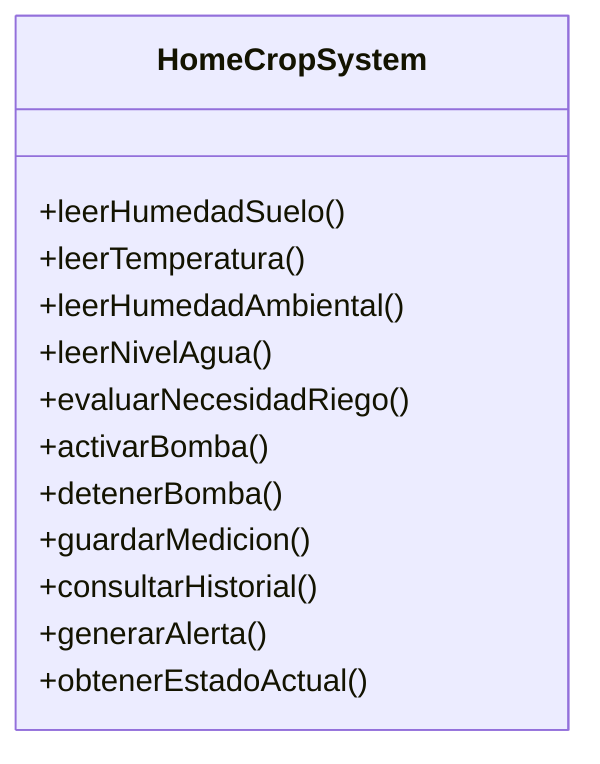

# Diagrama del diseño original de HomeCrop IoT

El diseño original se representa mediante una clase principal denominada `HomeCropSystem`, la cual concentra las diferentes responsabilidades planteadas para el funcionamiento del sistema.

## Descripción

En este diseño, `HomeCropSystem` concentra en una sola clase las principales funciones del proyecto:

- Lectura de sensores.
- Evaluación de la necesidad de riego.
- Control de la minibomba.
- Registro y consulta de mediciones.
- Generación de alertas.
- Consulta del estado del sistema.

Esta representación permite observar que una sola clase tendría que encargarse de diferentes áreas del sistema, lo que servirá como punto de partida para analizar los problemas de diseño y proponer estructuras con responsabilidades mejor distribuidas.
