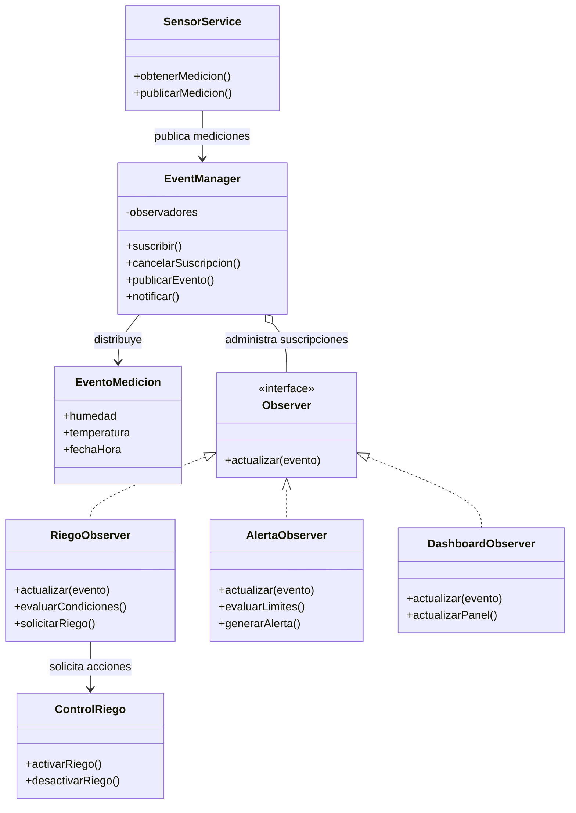

# Diagrama de clases — HomeCrop IoT
## Patrón Observer y arquitectura basada en eventos

## Descripción del diagrama

- **SensorService:** obtiene los datos de los sensores.
- **EventManager:** administra las suscripciones y distribuye los eventos.
- **EventoMedicion:** contiene la información de cada medición.
- **Observer:** define el contrato común para los componentes que reciben eventos.
- **RiegoObserver:** evalúa las condiciones para solicitar el riego.
- **AlertaObserver:** detecta condiciones que requieren una alerta.
- **DashboardObserver:** actualiza la información mostrada en el panel.
- **ControlRiego:** ejecuta las acciones de riego autorizadas por el sistema.