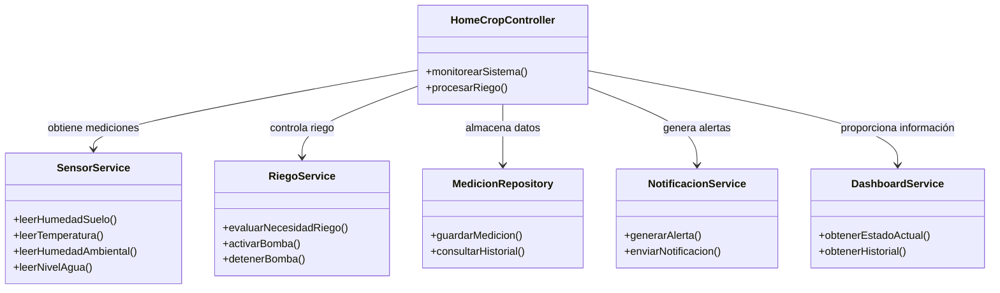

# Diagrama de la propuesta de mejora - Mauricio

La propuesta divide las responsabilidades de `HomeCropSystem` en clases especializadas y mantiene una clase coordinadora para organizar la interacción entre los componentes.

## Explicación del diseño

`HomeCropController` funciona como coordinador del sistema. En lugar de realizar directamente todas las tareas, solicita cada operación a la clase especializada correspondiente.

`SensorService` se ocupa exclusivamente de obtener las lecturas de los sensores.

`RiegoService` contiene la lógica relacionada con la decisión y ejecución del riego.

`MedicionRepository` se encarga del almacenamiento y consulta de las mediciones.

`NotificacionService` administra las alertas y notificaciones dirigidas al usuario.

`DashboardService` proporciona la información que será utilizada para mostrar el estado actual y los datos históricos del sistema.

La separación permite modificar un componente sin tener que cambiar toda la lógica del sistema.
